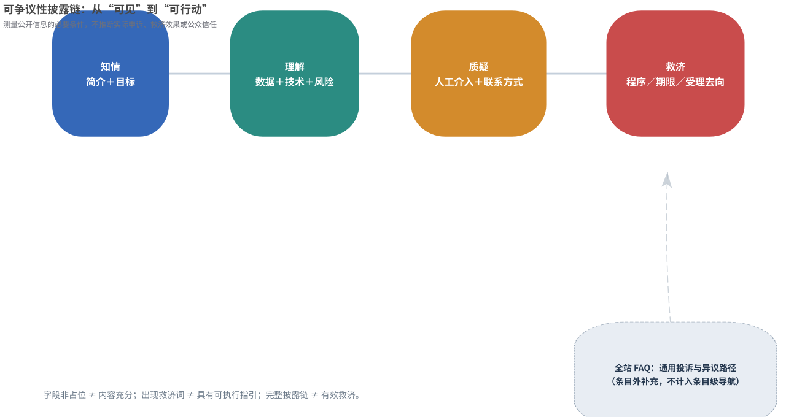
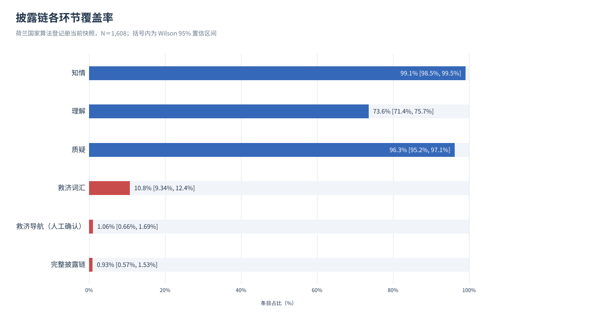
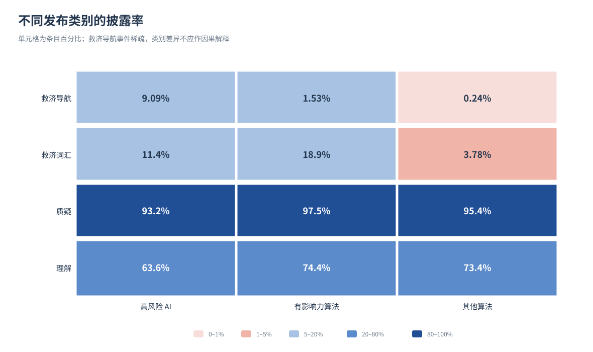
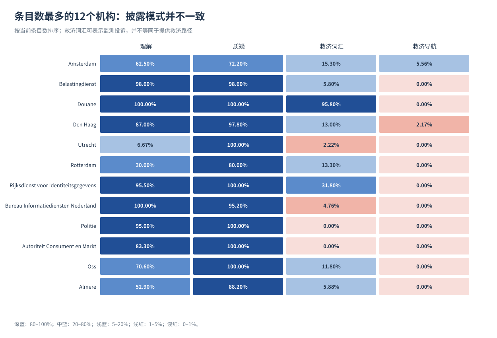
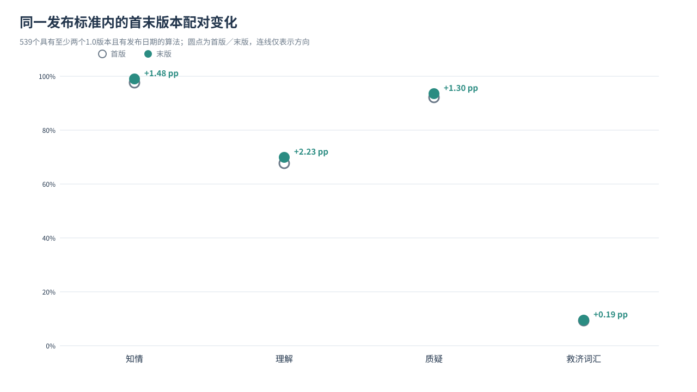

# 可见之后，如何质疑？公共算法登记册的可争议性披露

## ——基于荷兰国家算法登记册1,608条记录与版本历史的混合方法研究

**研究日期：**2026年10月28日  
**数据快照：**2026年10月28日  
**研究类型：**公共部门算法治理；全量横断面分析；同标准版本配对；结构化文本与制度文件分析

## 摘要

公共算法登记册通常以“让算法可见”为治理起点，但可见并不自动意味着受影响者能够理解、质疑并寻求纠正。本文将研究重心从一般透明度转向**可争议性披露**，提出“知情—理解—质疑—救济”的条目级分析框架，并对荷兰国家算法登记册开展混合方法研究。定量部分使用官网2026年10月28日当前全量快照的1,608条算法记录和含历史版本的3,035条记录，测量非占位披露、可机读联系方式、救济词汇及具体救济导航；以Wilson区间、机构等权bootstrap、字符门槛敏感性分析、同一1.0标准内首末版本McNemar精确检验和按机构聚类的探索性模型检验稳健性。定性部分复核全部自动救济导航候选、随机抽取其他救济词命中记录，并比较正例、反例、发布标准讨论、官网FAQ与Algoritmekader。

结果显示，登记册在“知情”和“质疑”的基础信息条件上接近普遍覆盖：1,594条（99.13%）同时提供非占位简介与目标，1,548条（96.27%）同时提供非占位人工介入说明和含邮箱、网址或电话的联系方式；但“理解”降至1,183条（73.57%），出现救济词汇的只有173条（10.76%）。自动规则产生22个救济导航候选，经逐条人工复核确认17条，仅占1.06%；同时满足知情、理解、质疑和救济导航的完整披露链仅15条，占0.93%。17条导航只分布于7个机构，南荷兰省与阿姆斯特丹合计贡献12条。高风险AI组的4条导航全部来自南荷兰省，因而不能将组间比例解释为风险分类的独立效应。在539个同一1.0标准内具有多个版本的算法中，首末版本之间的知情和理解分别提高1.48和2.23个百分点，McNemar精确检验p值分别为0.0078125和0.0018311；救济词汇只提高0.19个百分点，且变化不显著。

本文的核心解释不是“登记册没有救济”，而是存在一种**披露链末端断裂**：一般法律救济、全站FAQ与机构行政程序仍然存在，但这些资源很少被翻译为算法条目内可定位、可采取行动的导航。登记册修订主要改善机构自描述，未同步改善救济信息；少数组织模板则表明，低成本、可复制的字段设计能够改变这一状况。本文由此主张把登记册从“算法目录”推进为“争议入口”，同时将条目级导航与决定通知、机构程序和独立监察连接起来。所有指标仅测量可争议性的必要信息条件，不推断实际申诉使用、救济效果、公众信任或算法合法性。

**关键词：**数字治理；公共部门算法；算法登记册；算法透明度；可争议性；有效救济；混合方法

## 一、问题提出：从“公开了多少”转向“公开后能做什么”

公共部门使用算法进行风险评估、资源分配、执法检查与行政服务时，受影响者面对的并不只是一个技术模型，而是由数据、规则、工作人员、组织程序和行政决定共同组成的社会技术系统。算法登记册由此成为一种重要的数字治理基础设施：它将原本分散在机构内部的算法用途、数据来源、运行方式、风险与人工介入说明汇集到公开界面。荷兰国家算法登记册提供当前记录及历史版本下载，且2025年8月的版本记录明确说明，历史下载扩展到了旧发布标准；2026年4月又加入组织ID字段，这为全量、可追踪的实证研究提供了条件（[荷兰国家算法登记册版本记录](https://algoritmes.overheid.nl/nl/footer/release-notes)）。

然而，登记册的公共价值不能只以字段填充率衡量。一个条目可以详细说明算法目标、模型类型和风险，却没有告诉受到不利决定影响的人向谁提出异议、在何时之前提出、通过哪个网页或柜台提出，也没有说明能否获得重新核查。反过来，条目出现“bezwaar”（异议）、“beroep”（上诉）或“klacht”（投诉）等词，也可能只是描述机构内部在监测投诉，或者算法本身用于处理他人的异议文书。由此，本文区分**提及救济**与**提供救济导航**：前者是词汇现象，后者要求同一字段中还出现程序、期限、受理去向或可执行链接等线索。

这一问题具有直接的理论意义。Ananny与Crawford指出，看见系统并不等于理解系统，更不等于获得治理能力；透明度若要服务于问责，必须与能够接收、解释和使用信息的制度关系相连（[Seeing without knowing](https://doi.org/10.1177/1461444816676645)）。Kemper与Kolkman进一步追问“向谁透明”，强调没有批判性受众就没有算法问责（[Transparent to whom?](https://doi.org/10.1080/1369118X.2018.1477967)）。本文把这一追问推进到行动层面：登记册是否只让专业观察者看到机构自描述，还是也为决定相对人保留了进入复核与救济程序的线索？

荷兰案例尤其适于检验这一问题。Algoritmekader明确要求公共机构解释算法结果如何形成、受影响者如何对算法后果提出异议，并指出公民应能迅速、容易地找到自己的权利和申诉方式；其受众表还把决定形成、异议可能性和联系方式列为受影响者需要的信息（[Algoritmekader：透明度](https://algoritmes.overheid.nl/algoritmekader/onderwerpen/transparantie/)）。另一项措施要求建立并监测投诉、异议和上诉流程，以便识别系统性问题（[Algoritmekader：投诉、异议与上诉](https://algoritmes.overheid.nl/algoritmekader/voldoen-aan-wetten-en-regels/maatregelen/6-imp-06-klacht-bezwaar-beroep)）。因此，条目级救济信息不是外加的理想，而是可以用该国自身治理规范检验的制度承诺。

本文回答四个相互衔接的问题：第一，当前登记册在知情、理解、质疑和救济四个环节上的披露覆盖如何，披露链在哪一步发生最大损耗？第二，不同发布类别、使用状态和组织之间有何差异，这些差异是否由少数大型机构或模板驱动？第三，在同一发布标准内，条目修订是否同时改善一般说明与救济信息？第四，定性案例和制度文件如何解释“救济词很多、行动指引很少”的现象？通过全量描述、版本配对和结构化文本解释的结合，本文试图给出既可复核又不过度推断的答案。

## 二、文献与理论：可争议性披露的链条

### （一）透明度、批判性受众与可争议性

透明度批判并不意味着公开信息没有价值，而是反对把公开视为问责的充分条件。Ananny与Crawford所批评的是一种从“观察”直接跳到“治理”的推理：技术内部可见并不必然揭示组织权力，信息公开也不必然产生纠正能力（[Ananny与Crawford](https://doi.org/10.1177/1461444816676645)）。应用到登记册，字段存在只能说明机构发布了某种叙述；它不能单独证明叙述准确、公众理解、记者能够追查，更不能证明不利决定会被改变。本文因此把指标限定为“必要信息条件”，并保留从披露到实际救济之间的经验断点。

“向谁透明”的问题进一步揭示了信息与受众之间的错配。Kemper与Kolkman认为，算法问责需要有兴趣、有能力的批判性受众；不同受众所能理解和使用的信息并不相同（[Kemper与Kolkman](https://doi.org/10.1080/1369118X.2018.1477967)）。登记册可以服务研究者、审计者、记者和公共组织自身，但受影响者还有更具体的程序需求：他们需要知道自己面对的是什么决定、能否要求人工复核、向哪里提出、以何种形式提出以及期限为何。若这些行动信息只存在于另一个网站、另一封信或机构内部知识中，登记册对批判性受众的支持就是不均衡的。

可争议性研究为这种行动导向提供了概念桥梁。Lyons、Velloso与Miller把可争议性概括为对算法决定提出争议的能力，并指出其含义与实现方式仍存在多种理解（[Conceptualising Contestability](https://doi.org/10.1145/3449180)）。Alfrink等人的设计框架则强调系统应对人的干预保持开放，决定相对人需要解释、干预请求和审查工具，人类控制者还应能够纠正或覆盖系统决定（[Contestable AI by Design](https://doi.org/10.1007/s11023-022-09611-z)）。这些研究提示：可争议性不是一段更长的模型说明，而是一条从知悉到介入、从表达异议到改变结果的制度通道。

本文不试图用登记册文本证明整个通道已经存在，而是考察通道入口是否被披露。一个条目若提供人工介入说明与可机读联系方式，只表示“质疑”的基础条件较好；若还提供六周期限、异议网页、数字柜台或法律部门，才表示“救济导航”这一最低行动条件出现。至于链接是否持续可用、工作人员是否回应、复核是否独立、结果是否真正纠正，需要另行开展用户研究、程序审计和案件研究，不能由本文的文本指标替代。

### （二）登记册研究及本文的增量定位

关于登记册的批评主要沿两条路径展开。一条关注选择性可见与象征性治理。Cath与Jansen在对阿姆斯特丹、赫尔辛基等城市登记册的分析中提出“Dutch comfort”和“舒适透明”批评，指出有限、较无争议的算法披露可能让治理停留在舒适区，并把更深层的政治冲突转化为技术行政问题（[Dutch Comfort](https://doi.org/10.5840/techne202323172)）。另一条路径考察登记册的实际组织作用。Nieuwenhuizen基于27名受访者和33份政策文件，发现登记册在外部透明方面可能近似“纸面现实”和清单练习，但也能产生组织学习、内部认知与纪律效应（[Algorithm Registers: A Box-Ticking Exercise or Meaningful Tool for Transparency?](https://doi.org/10.1177/15701255241297107)）。两者共同提醒研究者：不能只数公开条目，也不能因公开不完备就否定所有组织价值。

与本文最接近的近期量化研究是Wenzlová于2025年完成的硕士论文。该研究使用截至2025年4月的869条记录，结合完整性与GPT-4辅助内容分析，评估目标、运行逻辑、风险和机构差异，并将结果置于形式透明与有意义透明的争论中（[Beyond Disclosure: Evaluating Algorithmic Transparency in the Dutch Algorithm Register](https://scripties.uba.uva.nl/download?fid=c13578141)）。这项研究说明“全量内容评估”本身已不再是空白，因此本文不宣称首次对全站进行透明度评分，也不以样本规模增长作为唯一贡献。

本文的增量有三点。其一，研究对象从一般披露质量转向可争议性，尤其区分救济词汇与条目内具体救济导航，并以人工复核反例防止把“处理异议的算法”误判为“可质疑的算法”。其二，除当前1,608条横断面外，本文在同一1.0标准内进行首末版本配对，以观察条目修订的方向，避免把不同字段制度直接拼成趋势。其三，分析规则、候选记录、人工判定和统计输出全部公开，不用不可复现的大模型主观评分替代可审计编码。

| 研究路径 | 主要问题 | 方法与证据 | 与本文的关系 |
|---|---|---|---|
| 透明度批判 | 可见是否等于可知、可治理 | 社会技术与问责理论 | 提供对“披露即问责”的反证边界 |
| 城市登记册批评 | 是否只披露安全、低争议对象 | 城市案例与制度分析 | 提醒关注选择性可见；本文转向已披露条目的行动入口 |
| 登记册组织研究 | 清单练习是否还有组织价值 | 27名受访者、33份政策文件 | 支持区分外部行动价值与内部学习价值 |
| Wenzlová（2025） | 全站披露是否完整、有意义 | 869条记录、GPT-4辅助内容分析 | 本文不重复“首次全量评分”主张，改测可争议性与版本变化 |
| 本文 | 可见之后能否找到质疑与救济入口 | 1,608条当前记录、3,035条历史记录、人工复核与制度文件 | 提供可复现的披露链、组织集中度和同标准配对证据 |

### （三）分析框架：知情—理解—质疑—救济

“知情”回答算法是否存在、为何使用；“理解”回答它使用什么数据、怎样运行、可能产生何种风险；“质疑”回答是否存在人工介入以及能否找到联系入口；“救济”回答受影响者能否从条目中找到具体程序、期限或受理去向。四者构成分析链条而非等权评分：前一环节通常有利于后一环节，但任何一环都不保证下一环自动成立，也不存在用一个总分掩盖末端缺失的理由。

这一框架把“可争议性披露”限定为文本中可观察的必要条件，而不是把可争议性整体压缩为四个二元变量。例如，非占位人工介入字段可能只写“工作人员会检查”，并未说明检查者是否有权改变决定；可机读邮箱可能属于一般联络而非申诉受理；即使条目给出六周期限和网页，也可能存在语言、数字接入、法律援助或独立性的障碍。因此，完整披露链应被理解为进一步审计的入口，而不是“有效救济已实现”的证书。

图1同时呈现本文的证据逻辑：定量部分测量各环节覆盖和损耗，定性部分检查词汇语境、组织模板与制度层级。两类证据在“披露链末端断裂”这一解释处汇合，但任何单一环节的数字都不能独立推出公众行为或法律结论。

## 三、研究设计

### （一）案例、数据来源与分析单位

本文以荷兰国家算法登记册为单案例嵌入式研究。主数据来自官网当前记录CSV下载接口，版本数据来自含历史版本CSV下载接口，语言参数为NLD；两个接口均为官网公开下载通道（[当前记录接口](https://algoritmes.overheid.nl/api/downloads/NLD?filetype=csv)；[历史记录接口](https://algoritmes.overheid.nl/api/downloads/history/NLD?filetype=csv)）。本文保存2026年10月28日原始快照，不随后续网页更新覆盖；固定哈希恢复脚本、来源清单、字段字典和完整处理代码随论文公开。官网版本记录说明，历史下载包含旧发布标准，这使跨版本检查成为可能（[版本记录](https://algoritmes.overheid.nl/nl/footer/release-notes)）。

横断面分析单位是一条当前算法记录，共1,608条，包含1,608个唯一算法标识和346个机构。按登记册原字段，高风险AI系统44条、有影响力算法718条、其他算法846条；在用1,461条、开发中78条、停用69条。历史文件有3,035行、1,629个唯一算法标识，其中661个算法具有多个版本。当前与历史文件的算法标识总数不同，是因为历史快照还可包含未进入当前快照的记录；本文不将两者强行视为同一闭合面板（[数据概况](outputs/summary.json)）。

版本分析只在同一1.0标准内部进行。对具有至少两个带有效发布时间记录的算法，按算法标识和发布时间排序，取首版与末版，形成539对。跨标准材料只作非等价描述，不计算“透明度上升率”或“救济下降率”。这一设计同时利用横断面的覆盖范围和同一算法内的版本可比性，但仍不能控制机构未登记、记录删除或发布时间误差带来的选择差异。

| 数据层 | 规模 | 主要用途 | 明确的分析边界 |
|---|---:|---|---|
| 当前全量快照 | 1,608条、346个机构 | 披露覆盖、类别与组织差异 | 描述已登记记录，不代表政府实际使用的全部算法 |
| 历史版本快照 | 3,035行、1,629个标识 | 识别多版本与标准变化 | 不是完整事件史，不推断未观察到的修改 |
| 同一1.0标准首末版 | 539对 | McNemar精确检验 | 只比较相同字段制度内的四个共同指标 |
| 旧标准与1.0并存算法 | 122个 | 字段制度的非等价描述 | 旧异议字段与当前救济导航不可直接换算 |

### （二）变量操作化与编码规则

“非占位披露”不是文本质量评分。脚本先统一空白和缺失值，再排除“n.v.t.”“niet bekend”“onbekend”“zie hierboven”等占位表达，主分析要求规范化文本至少20个字符。字符数只用于剔除极短标签和无信息占位，不表示越长越透明，也不判断技术叙述是否准确。为检验门槛依赖，另以1和40个字符重复计算。完整占位表与规则见[分析脚本](analysis/analyze.py)。

联系方式采用字段内搜索而非整字段严格匹配：只要`contact_email`字段含符合形式的邮箱、HTTP／www网址或荷兰电话号码，即记为“含可机读联系方式”。这能识别一个字段中同时写有说明文字、多个邮箱或电话的情况，但不验证邮箱是否真实存在、链接是否可访问或电话是否接通。救济词汇在简介、目标、比例性、法律依据、来源数据、技术与模型、人工介入、风险、影响评估和联系方式等字段中检索；救济导航要求救济词与行动线索出现在**同一字段**，以减少跨字段偶然共现。

行动线索包括期限、监察员、异议委员会、投诉表、异议书、法院、法律部门、数字柜台、向市政府提出异议、网址和邮箱。自动规则先产生候选，再由人工阅读相关字段作条目级判定。只有自动候选全部复核，不能据此声称所有阴性都已逐条验证；因此本文另从其他救济词命中记录中按固定种子20261028随机抽取40条复核。最终人工复核表共62条：22个全部自动候选和40个随机其他命中记录，判定理由逐条公开（[人工复核表](analysis/remedy_manual_review.csv)）。

| 指标 | 操作化定义 | 能说明什么 | 不能说明什么 |
|---|---|---|---|
| 知情 | 简介与目标均达到非占位披露 | 基本存在与用途信息已发布 | 信息准确、易懂或完整覆盖实际算法 |
| 理解 | 来源数据、技术运行、风险三者均非占位 | 三类理解材料同时存在 | 技术可解释性、风险披露充分性 |
| 质疑 | 人工介入非占位，且联系方式字段含邮箱、网址或电话 | 存在人工说明和可提取联系入口 | 人工有权纠正、联系方式实际可用 |
| 救济词汇 | 任一检索字段出现异议、上诉或投诉词 | 文本涉及救济相关语义 | 公众获得救济路径 |
| 救济导航 | 同一字段含救济词及程序、期限或受理去向，并经人工确认 | 条目内出现最低行动线索 | 实际申诉、独立复核或有效纠正 |
| 完整披露链 | 知情、理解、质疑、救济导航同时为真 | 四类必要信息条件共现 | 算法合法、公平或救济有效 |

### （三）定量分析策略

主分析是全量描述，不从样本推断一个更大的“已登记记录总体”；Wilson 95%区间用于表达二项比例在重复快照或编码不确定性下的统计精度，而不是弥补覆盖偏差。类别和状态比较报告各组数量、比例、区间、卡方统计量、Cramér's V及最小期望频数。对于救济导航和完整链等稀疏结果，最小期望频数远低于常规卡方近似要求，因此正文不把这些p值作为可靠证据，而以计数、组织来源和定性追踪为主。

为降低大型机构对全站比例的支配，本文计算机构内比例后对346个机构等权平均，并以固定种子进行2,000次机构重抽样bootstrap。还分别改变非占位字符门槛、仅保留在用记录，观察核心结论是否依赖单一设定。多变量部分只对事件充足的“理解”拟合探索性logistic GLM，纳入发布类别、状态和机构条目数对数，并使用按机构聚类稳健标准误；稀疏救济结果不报告易完全分离的回归。

版本比较使用同一算法首末版的2×2配对表，以不一致对进行双侧McNemar精确二项检验。由于当前人工救济标签不能直接套用到历史文本，配对推断仅用于知情、理解、质疑和救济词汇，不报告历史救济导航的人工确认变化。所有检验都是描述性、探索性证据；没有随机分配、时间序列反事实或外生冲击，因而不作因果推断。

### （四）定性分析、案例选择与证据三角互证

定性部分采用结构化文本分析与制度文件分析，而非访谈。第一类材料是救济词命中的语境：对22个自动候选逐条判断其是否真正提供针对本算法、其输出或相关行政决定的救济入口；对40个随机其他命中记录检查是否存在自动规则遗漏的行动信息。第二类是有目的地比较正例与反例，包括南荷兰省通用联系模板、阿姆斯特丹与阿纳姆的具体期限和网页，以及Douane大量“监测投诉”文本。第三类是发布标准仓库中关于独立`objection_procedure`字段的讨论、官网FAQ和Algoritmekader（[标准讨论Issue #7](https://github.com/Algoritmeregister/standard/issues/7)；[官网FAQ](https://algoritmes.overheid.nl/nl/footer/vragen)）。

案例选择遵循解释而非“挑最好和最差”的原则。全部正例用于识别可复制做法，全部5个被人工否决的AiBezwaar候选用于展示名称与业务语境造成的假阳性，Douane则作为高频救济词却零导航的离群反例。制度文件用于区分条目、机构、全站与法律程序四个层级，防止把“条目没有写”误译为“社会完全不存在救济”。由于只有一名研究者进行最终人工判定，复核表公开了每条理由，但不报告虚构的双人编码一致性。

混合方法的汇合点有三处：全站比例确定现象规模，组织与版本比较定位差异结构，文本和制度材料解释同一词汇为何具有不同功能。若定性材料与数字不一致，优先回到原始字段修订规则，而不是选择性删除异常。初版规则曾因遗漏数字柜台、向市政府异议和联系方式中的法律部门而低估候选，也曾把AiBezwaar业务文本误计为真阳性；这些修正均保留在代码与复核记录中。

## 四、定量结果

### （一）披露链在救济环节发生数量级损耗

当前1,608条记录中，知情条件覆盖1,594条，比例99.13%，Wilson 95%区间为98.54%—99.48%；理解条件覆盖1,183条，比例73.57%，区间为71.36%—75.67%；质疑条件覆盖1,548条，比例96.27%，区间为95.23%—97.09%。从字段看，来源数据、技术模型与风险各自的非占位覆盖分别为85.51%、84.70%和90.67%，但三者必须同时满足使“理解”降至73.57%。人工介入和可机读联系方式的单字段覆盖分别为97.57%和98.69%，二者组合后的质疑仍为96.27%（[字段覆盖](outputs/field_coverage.csv)）。

救济相关指标出现断崖式下降。173条记录出现救济词汇，占10.76%；经人工确认的救济导航只有17条，占1.06%，Wilson区间为0.66%—1.69%；完整披露链只有15条，占0.93%，区间为0.57%—1.53%。救济词覆盖率约为救济导航的10.2倍，说明“文本谈到投诉或异议”远远不等于“条目告诉读者怎样行动”。这不是一个连续、平滑的透明度梯度，而是末端制度信息的结构性稀缺（[主覆盖结果](outputs/coverage.csv)）。

| 披露环节 | 数量 | 占1,608条比例 | Wilson 95%区间 |
|---|---:|---:|---:|
| 知情 | 1,594 | 99.13% | 98.54%—99.48% |
| 理解 | 1,183 | 73.57% | 71.36%—75.67% |
| 质疑 | 1,548 | 96.27% | 95.23%—97.09% |
| 救济词汇 | 173 | 10.76% | 9.34%—12.37% |
| 救济导航（人工确认） | 17 | 1.06% | 0.66%—1.69% |
| 完整披露链 | 15 | 0.93% | 0.57%—1.53% |

结果并不支持“机构完全没有填写内容”的简单判断。相反，知情和质疑的基础字段接近饱和，理解也有近四分之三覆盖，说明登记册已具备相当广泛的机构自描述能力。真正的断点在于，这些描述很少进一步连接到具体救济程序。后文的Douane与AiBezwaar案例将说明，单纯增加关键词或文本长度无法修复这一断点。

### （二）类别与状态差异：稀疏比例必须回到组织来源

高风险AI系统的救济导航为4/44（9.09%），有影响力算法为11/718（1.53%），其他算法为2/846（0.24%）。表面上，高风险组比例明显较高；但逐条追踪显示，这4条全部来自南荷兰省同一联系方式模板。换言之，观察到的组间差异完全可由一个机构的登记实践解释，不能据此推断高风险分类促使机构普遍提供更好的救济信息。救济导航和完整链的卡方最小期望频数分别只有0.465和0.410，也进一步限制了渐近p值的解释力（[类别结果](outputs/category_tests.csv)）。

“理解”在三类之间相对接近：高风险AI为28/44（63.64%），有影响力算法为534/718（74.37%），其他算法为621/846（73.40%）。高风险组知情为40/44（90.91%），低于另两组的99%以上；该结果提醒研究者，风险标签并不自动带来更完整的公开说明。由于高风险组只有44条且机构分布不均，本文把类别比较视为登记实践的描述，而不是对欧盟AI法风险等级或算法实际危害的评估。

| 发布类别 | 条目数 | 知情 | 理解 | 质疑 | 救济导航 | 完整链 |
|---|---:|---:|---:|---:|---:|---:|
| 高风险AI系统 | 44 | 90.91% | 63.64% | 93.18% | 9.09%（4条） | 6.82%（3条） |
| 有影响力算法 | 718 | 99.58% | 74.37% | 97.49% | 1.53%（11条） | 1.39%（10条） |
| 其他算法 | 846 | 99.17% | 73.40% | 95.39% | 0.24%（2条） | 0.24%（2条） |

状态差异主要体现在理解与质疑。停用条目理解覆盖49.28%，在用条目75.36%，开发中条目61.54%；质疑覆盖分别为85.51%、96.99%和92.31%。救济导航在停用、在用和开发中分别为2、13和2条，总数过小，不适合据此排列“生命周期治理绩效”。这些差异可能与条目维护、机构构成、历史模板和停用后的信息保留方式共同相关，不能解释为“投入使用导致透明度提高”（[状态结果](outputs/status_tests.csv)）。

### （三）组织集中度：少数模板塑造全站救济导航

17条救济导航分布于7个机构：南荷兰省8条，阿姆斯特丹4条，Zeist、Skal、Arnhem、CBR和海牙各1条。南荷兰省与阿姆斯特丹合计12条，占全部导航的70.59%。在南荷兰省13条记录中，8条具有救济导航、7条形成完整链；其做法不是逐案撰写复杂法律说明，而是在联系方式字段重复提供法律部门、邮箱和网页。阿姆斯特丹72条记录中4条具有导航，四条的程序内容则更接近具体业务场景（[机构汇总](outputs/organization_summary.csv)；[人工复核表](analysis/remedy_manual_review.csv)）。

机构间“理解”差异也很显著。Douane、Belastingdienst、Arnhem等机构接近或达到全量覆盖，而Utrecht为3/45（6.67%），Rotterdam为9/30（30.00%），Tilburg为4/14（28.57%）。这些数字描述当前公开字段，而不是对机构整体能力排名；同一机构可能使用统一模板，使少量填写习惯在数十条记录中重复出现。因此，条目加权比例既反映机构实践，也反映机构在登记册中的条目数量。

| 机构 | 条目数 | 理解 | 救济导航数 | 完整链数 | 主要解释线索 |
|---|---:|---:|---:|---:|---|
| 南荷兰省 | 13 | 92.31% | 8 | 7 | 联系方式模板列出法律部门、邮箱与网页 |
| 阿姆斯特丹 | 72 | 62.50% | 4 | 4 | 数字柜台、六周期限、数据重新核查等 |
| Arnhem | 16 | 100.00% | 1 | 1 | 异议网站、六周期限与书面选项 |
| 海牙 | 46 | 86.96% | 1 | 1 | WOZ决定的六周期限与复核说明 |
| Douane | 48 | 100.00% | 0 | 0 | 46条出现救济词，但主要是内部／外部投诉监测 |
| Utrecht | 45 | 6.67% | 0 | 0 | 三类理解字段未同时达到非占位标准 |

机构等权分析进一步说明集中度的影响。条目加权的救济词覆盖为10.76%，机构等权后降至7.25%；救济导航由1.06%降至0.83%，完整链由0.93%降至0.52%。相反，理解由73.57%升至76.42%，说明大型机构并不是所有指标上都代表“更透明”。对救济指标而言，条目加权结果尤其受Douane和南荷兰省等模板化机构影响（[机构等权结果](outputs/organization_equal_weight.csv)）。

### （四）同一1.0标准内的版本变化：一般说明改善，救济词近乎停滞

539个同标准配对中，知情由首版526条（97.59%）升至末版534条（99.07%），提高1.48个百分点；8个算法从不满足变为满足，0个反向变化，McNemar精确p＝0.0078125。理解由365条（67.72%）升至377条（69.94%），提高2.23个百分点；13个改善、1个下降，p＝0.0018311。由于分析保持算法和字段标准不变，这些结果比跨机构横断面更接近“条目编辑发生了什么”的直接证据（[配对结果](outputs/paired_within_v1.csv)）。

质疑由497条（92.21%）升至504条（93.51%），提高1.30个百分点；9个改善、2个下降，p＝0.06543，在常规5%水平下证据不足。救济词汇由50条（9.28%）升至51条（9.46%），只提高0.19个百分点；2个改善、1个下降，精确p＝1.0。也就是说，版本修订在知情和理解上呈现可观察改善，但没有显示救济语义的同步扩展。

| 指标 | 首版 | 末版 | 变化（百分点） | 改善／下降对 | McNemar精确p |
|---|---:|---:|---:|---:|---:|
| 知情 | 97.59% | 99.07% | +1.48 | 8／0 | 0.0078125 |
| 理解 | 67.72% | 69.94% | +2.23 | 13／1 | 0.0018311 |
| 质疑 | 92.21% | 93.51% | +1.30 | 9／2 | 0.0654297 |
| 救济词汇 | 9.28% | 9.46% | +0.19 | 2／1 | 1.0 |

这些结果不能被表述为“登记册制度导致透明度提升”，因为配对只包含持续存在且有多个版本的算法，可能选择维护较积极的机构；首末版间隔也不一致。更稳妥的结论是：在可观察的条目修订中，编辑活动主要集中于基本说明与理解材料，救济信息没有呈现同等幅度的变化。这与字段制度把一般描述置于中心、把救济程序留给机构通用页面的结构相一致，但后一解释仍需定性材料支持。

### （五）敏感性分析与探索性模型：核心断点稳定，关联解释受限

将非占位门槛从20字符改为1或40字符，救济词汇、人工确认救济导航的数量均不变；完整链分别为16、15和14条，对应1.00%、0.93%和0.87%。知情在40字符门槛下仍为98.45%，理解为71.14%，质疑为96.02%。只看1,461条在用记录时，主口径下救济导航为13条（0.89%），完整链为12条（0.82%）。因此，“末端稀缺”不是20字符门槛或停用条目造成的假象（[敏感性结果](outputs/sensitivity.csv)）。

机构等权bootstrap也没有改变方向。理解的机构等权均值为76.42%，95% bootstrap区间为73.15%—79.68%；救济导航为0.83%，区间0.08%—1.86%；完整链为0.52%，区间0.04%—1.29%。稀疏指标的区间较宽，正说明少数记录与机构对结果影响较大，不宜给出过度精确的政策排名。

探索性聚类GLM中，以停用条目为参照，在用条目与“理解”的比值比为0.326，95%聚类稳健区间0.184—0.577，p＝0.000120；开发中条目OR为0.607，区间0.292—1.261。以高风险AI为参照，有影响力与其他类别的区间均跨1；机构条目数对数的OR为1.023，区间0.712—1.471（[聚类模型](outputs/clustered_models.csv)）。

看似矛盾的是，状态描述中“在用”比例较高，而多变量模型中相对“停用”的OR低于1。该反转提示机构构成与模型设定正在改变比较含义，也再次说明不宜将状态解释为生命周期因果效应。本文只把模型作为敏感性材料，不以其覆盖更直观的全量和配对结果；对救济结果则坚持不拟合稀疏回归，避免完全分离产生虚假的巨大系数。

## 五、结构化定性比较：救济词为什么不等于救济路径

### （一）AiBezwaar假阳性：算法处理异议，不代表算法可以被质疑

自动规则初筛得到的22个候选中，有5个名称含AiBezwaar的记录被人工否决。这些系统分布于Heusden、Aalten、Hollands Kroon、Heemskerk和Aa en Hunze，其业务是识别、分类或处理市民提交的异议文书。文本因此自然包含“bezwaar”，甚至同时出现期限、网页或邮箱；若只做关键词共现，就会把它们视为救济导航正例。

人工阅读后可见，这些字段描述的是算法所服务的行政流程，而不是针对本算法输出或相关决定的新救济入口。一个用于加速处理异议的系统，可能本身也存在错误分类、遗漏或不当自动化风险；“它处理异议”与“它向受影响者提供质疑该处理的方式”是两个不同命题。剔除这5条不是降低数字以迎合论点，而是保持概念与测量一致（[5条否决记录及理由](analysis/remedy_manual_review.csv)）。

这一反例揭示了可争议性文本分析的一般困难：程序词汇具有多重语义角色。它们可以指向公众权利、机构内部监控、算法业务对象、历史法律依据，甚至只是说明某类私法行为不可异议。自然语言规则能够提高筛查效率，却不能独立判定行动指向。本文因此把自动输出称为“候选”，将17条而非22条作为最终导航数，并公开人工理由供他人推翻。

随机复核的40条其他救济词命中记录中，没有发现额外的条目内具体程序、期限或受理去向。这支持自动规则没有明显漏掉同类型正例，但40条不是对全部阴性记录的完整审计，不能据此计算严格召回率。更谨慎的表述是：最终结果对全部自动候选进行了精确性复核，并对其他命中进行了可复现的抽样检查；未来研究可通过双人全量复核进一步估计漏检。

### （二）Douane反例：投诉监测是组织学习，不是公众行动导航

Douane是理解“词汇—导航落差”的关键案例。其48条当前记录中，46条出现救济词汇，覆盖95.83%，但救济导航为0条。典型文本写道，海关会监测内部和外部投诉与事件，例如某个风险画像错误地产生命中，使过多申报被标为高风险。这类说明具有明确的治理价值：它表明机构试图通过投诉和事件识别模型问题，与Algoritmekader所倡导的流程监测相呼应（[Douane原始记录示例：算法ID 18448652](https://algoritmes.overheid.nl/api/downloads/NLD?filetype=csv)；[监测流程规范](https://algoritmes.overheid.nl/algoritmekader/voldoen-aan-wetten-en-regels/maatregelen/6-imp-06-klacht-bezwaar-beroep)）。

但是，监测逻辑与救济逻辑的受众方向相反。前者把投诉作为组织获取反馈、改进系统的输入，后者把受影响者作为需要知道如何行动的主体。仅写“我们监测投诉”没有回答投诉向谁提交、通过何种渠道、期限为何、是否会重新审查个案。Douane的高救济词比例不能被解释为对公众最友好，也不能被解释为没有投诉制度；它只能说明当前条目主要采用组织视角而非行动视角。

这一反例也修正了“文本越长越透明”的直觉。Douane的理解覆盖为100%，救济词又极为常见，如果把这些特征合成为一个线性透明度总分，它很可能得到较高评价；但这会掩盖条目级行动入口的缺席。披露链方法刻意不给总分，正是为了保留这种结构性差异：机构可以在内部监测和一般说明上表现充分，同时在公众救济导航上仍为空白。

从积极方面看，投诉监测与公众导航并不冲突，反而可以形成闭环。机构通过投诉识别系统性风险，再把高频问题转化为更清晰的条目说明、复核标准和纠错机制；条目导航则降低反馈进入机构的门槛。政策设计需要同时保留这两种视角，而不是用一方替代另一方。

### （三）正例比较：期限、去向与纠正可能性构成最低行动信息

 Arnhem的停车扫描车条目先说明车牌被错误识别可能导致不当罚款，随后给出异议网站、六周期限以及书面异议选项。这里同时出现风险、具体网页、期限和替代提交方式，读者不必仅凭一般联系方式猜测下一步。CBR的驾驶适格性评估条目在风险字段中给出针对决定提出异议的具体网页；Skal监督模型则说明，经营者不同意评分或分类时可在六周内提出异议（[Arnhem：算法ID 73165981](https://algoritmes.overheid.nl/api/downloads/NLD?filetype=csv)；[CBR：算法ID 33869878](https://algoritmes.overheid.nl/api/downloads/NLD?filetype=csv)；[Skal：算法ID 74823752](https://algoritmes.overheid.nl/api/downloads/NLD?filetype=csv)）。

阿姆斯特丹的案例进一步显示“救济导航”不必是冗长法律文本。广告税图像识别条目在人工介入字段说明可对税单提出异议或上诉，并指向税务数字柜台；贫困救助收入分类条目说明申请人可在六周内对决定提出异议，若发生异议，数据可被重新查看，必要时重新查询Suwinet。后者不仅告知期限，还把救济与数据纠正连接起来，更接近可争议性所要求的实际介入可能（[广告税识别：算法ID 67971871](https://algoritmes.overheid.nl/api/downloads/NLD?filetype=csv)；[收入分类：算法ID 29355466](https://algoritmes.overheid.nl/api/downloads/NLD?filetype=csv)）。

海牙WOZ估值条目则把算法输出嵌入可异议的行政决定：文本说明利害关系人可在决定日期后六周内提出有理由的异议，并指出处理异议时会评估理由、必要时修正底层数据和WOZ估值，异议决定还可继续上诉。该例的重要性不在于篇幅长，而在于明确了“算法输出—行政决定—异议—数据修正—后续上诉”的关系（[海牙WOZ：算法ID 41525861](https://algoritmes.overheid.nl/api/downloads/NLD?filetype=csv)）。

| 正例 | 条目内行动线索 | 相比“可以异议”多出的信息 | 仍需另行验证的事项 |
|---|---|---|---|
| Arnhem停车扫描车 | 网站、六周、书面选项 | 去哪里、何时前、以何种方式 | 网页可用性与实际处理质量 |
| CBR驾驶适格性 | 针对决定的具体异议网页 | 救济对象与入口 | 是否覆盖算法相关争议 |
| Skal监督模型 | 对评分或分类六周内异议 | 可争议对象与期限 | 复核独立性与改判情况 |
| 阿姆斯特丹广告税 | 税务数字柜台、异议与上诉 | 受理去向 | 柜台是否提供有效个案支持 |
| 阿姆斯特丹收入分类 | 六周、重新查看数据、重新查询 | 救济与数据纠正的连接 | 纠正是否实际发生 |
| 南荷兰省模板 | 法律部门、邮箱、网页 | 稳定、可复制的机构去向 | 通用模板与个案算法的关联强度 |

这些正例共同支持一个克制的设计判断：最低行动信息可以由少数结构化元素组成，并不要求公开源代码或完整法律意见。具体去向、期限、可争议对象和是否重新核查，已经能显著降低从“读到算法”到“开始质疑”的搜索成本。它们也不能证明程序公平，但为后续用户测试和程序审计提供了可追踪起点。

### （四）字段制度：行政决定的救济对象与条目的导航功能可以并存

发布标准仓库的公开讨论曾提出移除独立`objection_procedure`属性，理由是异议针对行政决定，而不是算法或算法输出本身；讨论还指出，可以引用机构通用异议说明，因为同一机构的各算法可能使用相同程序（[Algoritmeregister标准Issue #7](https://github.com/Algoritmeregister/standard/issues/7)）。这一法律—架构论辩有合理之处：如果文本暗示公众应“对模型提出上诉”，确实可能混淆技术组件与法律决定。

但救济对象与导航功能并不矛盾。条目无需主张“对算法本身上诉”，仍可说明与该算法相关的决定是否可异议、应向哪个机构或网页提出、期限如何计算。Arnhem、海牙等正例正是把算法输出放回行政决定链条，而不是制造一个独立的“算法上诉权”。因此，删除独立字段可以避免概念混乱，却不必导致条目级行动信息消失；结构化链接或统一救济区块是两种可以并存的设计。

历史数据提供了非等价描述的背景。在122个同时具有旧标准和1.0版本的算法中，旧版独立异议程序字段有35条达到最低非占位条件，旧版决策过程、监测和绩效标准分别为79、52和53条；当前记录中19条出现救济词，8条具有人工确认救济导航。旧字段与当前指标的定义不同，不能据此计算下降率或断言某种制度变化造成透明度倒退（[跨标准描述](outputs/cross_standard_descriptive.csv)）。

更稳妥的解释是，字段制度改变了信息被放置和被期待的位置。独立字段提示发布者考虑异议程序；没有该字段时，救济信息可能进入风险、人工介入或联系方式，也可能完全留给机构通用网页。当前17条正例证明后一种结构仍能容纳导航，1.06%的总体覆盖则说明这种容纳并未成为普遍实践。制度分析的对象因此应是“如何保证行动信息可达”，而不是简单恢复某个旧字段名称。

### （五）全站FAQ与条目层级的差异：稀缺不等于完全无救济

官网FAQ设有“在哪里对登记册中的政府算法提出投诉或异议”的问题，答案引导公众首先向使用该算法的机构提出；若双方无法共同解决，可寻求国家监察员帮助（[荷兰国家算法登记册FAQ](https://algoritmes.overheid.nl/nl/footer/vragen)）。因此，本文不能也不应写成“官网没有申诉指引”。全站通用说明是救济基础设施的一部分，也为条目没有重复法律文字提供了一定理由。

问题在于信息层级与发现路径。一个从具体算法条目出发的读者，需要意识到FAQ中存在通用答案，再识别主管机构、寻找其投诉或异议页面，并判断一般行政程序是否适用于自己的决定。条目级导航并不要求复制全部FAQ，而是通过一个稳定链接或简短字段降低这几步搜索成本。全站通用指引与条目级具体指引应被视为互补层，而非相互替代。

这一层级区分也限定了政策含义。1.06%不是“只有1.06%的算法允许异议”，0.93%也不是“只有0.93%的公众能得到有效救济”。它们表示在当前公开条目的文本中，只有这些记录同时呈现了本文定义的信息条件。公众可能通过决定信、机构网站、法律援助或监察员获得救济；同样，条目写了期限和网页也不保证实际程序及时、独立和有效。

因此，披露链末端断裂是一种**接口问题**，不是对荷兰行政救济体系整体的存在性判决。登记册若希望成为面向受影响者的公共治理工具，就应将已有的全站与机构资源连接到算法条目；若其目标仅是研究者和审计者的目录，则应在受众说明中明确这一边界，避免把目录覆盖误当作可争议性已经实现。

## 六、综合讨论

### （一）理论解释：从“透明幻觉”到“披露链末端断裂”

本文结果与透明度批判相呼应，但给出了更具体的经验定位。问题不是所有字段都空洞，也不是登记册毫无价值；知情和联系方式接近普遍、理解超过七成，说明大规模公开自描述已经成为现实。真正稀缺的，是把信息转换为争议行动的末端连接。由此，“透明幻觉”若存在，并不主要表现为所有内容都是表演，而可能表现为前端可见性很高掩盖了后端行动入口不足（[Ananny与Crawford](https://doi.org/10.1177/1461444816676645)）。

“披露链末端断裂”比单一透明度评分更能解释反例。Douane具备充分的数据、技术与风险说明，也频繁讨论投诉，却没有公众导航；AiBezwaar在字面上充满救济词，却把救济作为算法处理对象；南荷兰省则用一个简短模板在多条记录中提供去向。三种情况若被合并为总分，最关键的差异会消失。链条方法保留各环节，因而能同时承认组织学习价值与外部行动缺口。

这一发现也细化了“批判性受众”命题。不同受众需要的不只是不同难度级别的同一文本，而是不同功能的信息。审计者可能需要数据、模型和风险，机构内部学习者需要投诉监测，决定相对人则需要复核入口、期限与受理去向。登记册若只优化前两类信息，就可能在专业可见性提高的同时，把最直接承受后果的人留在通用网站搜索之中（[Kemper与Kolkman](https://doi.org/10.1080/1369118X.2018.1477967)）。

可争议性由此不是透明度的同义词，也不是透明之后自然到来的结果。它要求公开文本与有权介入的人和程序建立关系。本文只测量这种关系的最浅层——条目中是否存在可追踪入口；但正是这一浅层在全站范围内高度稀缺，说明“从解释到干预”的转化不能被视为自动发生（[Alfrink等](https://doi.org/10.1007/s11023-022-09611-z)）。

### （二）组织模板与版本证据：缺口可修复，但不会随一般编辑自动消失

南荷兰省和阿姆斯特丹合计贡献12/17条导航，说明条目级救济并非技术上难以实现，也不是只有资源最充足的中央机构才能提供。南荷兰省模式证明通用机构程序可以通过模板进入多个条目；阿姆斯特丹、Arnhem和海牙模式证明具体业务字段可以嵌入期限、网页和纠正说明。两种模式分别适合标准化与场景化，不必相互排斥。

组织集中度同时构成警示。高风险AI组4条导航全部来自南荷兰省，如果只看类别百分比，就可能把模板效应误读为风险治理效应。类似地，Douane的大量救济词会抬高“有影响力算法”组的词汇覆盖，却不增加任何导航。全站指标必须与组织来源和原始语境共同阅读，否则统计汇总本身会制造新的透明幻觉。

539对版本结果则显示，条目编辑并不会自动修复末端缺口。知情和理解分别有8/0、13/1的净改善方向，救济词只有2/1，几乎不变。这里不能推断编辑者“故意忽视救济”，但可以观察到一个实际优先级：已经发生的修订更多改善机构自描述，而非行动入口。若没有专门字段、发布提示或审核要求，一般性维护可能继续复制这一差异。

因此，政策干预不应只呼吁“提高透明度”或“增加文本长度”，而应改变信息架构和检查点。一个稳定的救济链接、一个期限字段、一个“是否可要求人工复核及其权限”的说明，比增加泛化叙述更直接。版本历史还应保留这些字段的变化，以便未来检验结构改革是否真正改善导航，而不是只改善页面观感。

### （三）治理设计：把算法目录连接为争议入口

第一项建议是建立**双层救济导航**。全站FAQ继续解释一般投诉、异议与监察员路径；每个条目则提供与主管机构或具体决定相关的稳定链接，并在适用时显示期限和提交方式。这样既避免重复整段法律文本，也减少读者从条目到机构程序的搜索成本。对不适用正式异议的私法行为或纯内部工具，应明确说明原因及是否存在投诉、监督或其他反馈渠道，而不是留空。

第二项建议是使用**结构化而非纯关键词的字段**。最低区块可包括：相关决定是否可异议；可争议对象是数据、分类、输出还是行政决定；受理机构与URL；期限；人工复核是否有权修改数据和决定；其他救济或监察渠道。字段应允许“不适用＋理由”，避免为了填满表格而制造误导性通用话术。机构可以维护一个权威模板，条目只覆盖需要个案化的部分。

第三项建议是保留**指标的非合成性**。若把知情、理解、质疑和救济合成单一分数，机构可能通过增加基本描述来补偿救济缺失。监测仪表盘应分别报告各环节，同时显示绝对数、机构来源和版本变化。对于救济导航这类稀疏指标，尤其不宜用卡方排名或单一年度百分比奖惩机构，否则可能激励模板化填充而非真实可用性。

第四项建议是把文本审计与**实际程序审计**分开衔接。登记册团队可以定期检查链接可访问性、联系方式响应、复核权限和纠正案例；独立研究者则可开展受影响者测试，观察从决定通知到登记册、机构页面和申诉提交的实际路径。公开登记册适合发现入口缺口，但只有用户研究和案件材料才能判断入口之后是否公平、及时和有效。

| 设计层 | 最低改进 | 防止的误区 | 可审计指标示例 |
|---|---|---|---|
| 全站层 | 保留通用FAQ、监察员与机构责任说明 | 把条目稀缺误写成社会无救济 | 指引可发现性、页面可达性 |
| 条目层 | 稳定救济链接、期限、受理去向、可争议对象 | 救济词代替行动信息 | 分层导航覆盖率、无效链接率 |
| 机构层 | 权威模板与个案字段结合 | 复制粘贴造成虚假具体性 | 模板版本、个案覆盖率 |
| 程序层 | 有权限的人工复核、数据纠正和反馈监测 | 只监测投诉而不解决个案 | 响应时间、纠正率、复核独立性 |
| 评估层 | 分环节报告，不合成单一透明度分 | 前端高覆盖掩盖末端缺失 | 披露链、组织集中度、同标准配对变化 |

### （四）替代解释与竞争假设

第一种替代解释是，条目级导航稀缺反映合理的法律分工：异议针对行政决定，相关信息应放在决定通知而非算法登记册。本文同意决定通知具有不可替代的法律责任，也不主张登记册成为唯一救济渠道。但“不是唯一渠道”不等于“无需任何链接”。如果登记册面向公众并声称帮助其理解算法后果，一个指向权威程序的入口仍然具有独立价值；后续研究应检验决定通知是否已经充分承担这一功能。

第二种解释是，重复机构通用救济文本会增加维护成本和过期风险。这个担忧成立，南荷兰省模板若部门或链接变化，多条记录可能同时过时。因此，建议的重点不是复制更多文字，而是使用单一权威来源、结构化引用和自动链接检查。条目保存快照与版本历史也有助于识别何时发生变化，但不能替代实际可用性监测。

第三种解释是，低导航率可能是编码保守造成的。本文要求同字段共现并人工排除业务性异议文本，确实可能漏掉分散在多个字段中的真实路径，也未逐一打开每个链接判断其内容。40条随机复核降低了这一担忧，却没有消除它。因此，17条应视为按本文保守规则确认的导航数，而不是所有可能行动信息的绝对上限；公开规则使其他研究者可以放宽条件并比较结果。

第四种解释是，登记册覆盖本身具有选择性，已登记条目可能偏向易说明、低争议系统，导致全站估计无法代表实际公共算法生态。本文无法否认这一点，也不以当前快照推断未登记算法。即使只把结论限制在“机构选择公开且当前可见的记录”，末端稀缺依然成立；若高争议系统更少进入登记册，实际治理问题甚至可能更复杂，但这需要独立的登记完整性研究才能证明。

## 七、结论与局限

### （一）主要结论

本文对2026年10月28日荷兰国家算法登记册的全量分析表明，公开算法信息已经具有广泛基础，但可争议性披露呈明显不均衡。知情为99.13%，质疑的基础条件为96.27%，理解为73.57%；救济词只有10.76%，人工确认的救济导航只有1.06%，完整披露链只有0.93%。最重要的数字不是某个总分，而是各环节之间数量级的落差。

差异主要由组织实践和模板塑造。17条导航只来自7个机构，南荷兰省与阿姆斯特丹占12条；高风险AI组看似较高的导航比例完全来自南荷兰省。Douane的46条救济词记录与0条导航、AiBezwaar的5个假阳性则共同证明，词频、字段长度和一般完整性不能替代行动语义判断。

同一1.0标准内539个首末版本配对显示，知情和理解有统计上可辨的改善，救济词汇几乎不变。结合字段讨论、FAQ和正例，本文将这一现象解释为披露链末端断裂：一般行政救济和全站指引存在，但很少被连接为条目内可采取行动的导航。修复方向不是无限增加披露，而是以双层链接、结构化救济区块、人工复核权限说明和持续程序审计，把目录与争议入口连接起来。

### （二）研究局限

第一，本文只分析已公开记录，无法估计荷兰政府实际使用的全部算法，也不能识别应登记而未登记的系统。登记选择、删除和分类均由机构参与，横断面结果不应外推为整个公共部门算法生态。

第二，非占位披露是最低门槛，不是语义质量评价。20字符规则不能判断描述是否准确、易懂或足以支持审计；可机读联系方式不代表实际可用；人工介入文本不证明介入者有权、有能力或愿意改变结果。救济导航也不证明申诉会被受理，更不证明救济有效。

第三，人工复核由一名研究者完成，全部22个自动候选虽均已检查，其他命中只随机复核40条，未进行双人全量编码。公开判定表有助于外部复核，但不能提供虚构的编码者一致性。规则依赖荷兰语及少量英语词汇，对不同表达、跨字段组合和链接后内容的识别有限。

第四，版本配对只覆盖同一1.0标准内持续存在且具有多个有效时间戳的算法，可能偏向维护活跃的机构；首末版间隔不同，也没有未修改对照组。McNemar结果说明已观察版本间的非对称变化，不证明平台制度或编辑行为产生因果效果。

第五，跨标准字段具有不同含义，本文没有把旧异议程序与当前救济导航直接计算为上升或下降。公开标准讨论能够说明设计争议，却不能单独证明某次讨论直接导致后续字段变化。对制度演进的因果过程仍需版本化标准文件、决策记录和参与者访谈。

第六，本文没有开展公众、公务员、监察员或法律援助者访谈，也未追踪真实投诉与诉讼。因而不能回答公众是否知道登记册、是否使用导航、程序是否独立、申诉是否及时或结果是否纠正。本文发现的是信息接口的缺口，不是救济体系整体绩效。

### （三）后续研究议程

后续研究首先应把条目审计扩展为“决定通知—算法条目—机构程序—独立救济”的全路径用户研究。可以招募不同数字素养和语言背景的参与者，观察他们能否找到正确入口、理解期限并提出复核请求，从而检验哪些字段真正降低行动成本。对高风险或高影响场景，还应比较登记册信息与个案决定信是否一致。

其次，应建立双人或多人全量复核，公开争议样本与编码裁决，并把链接可访问性、回应时长、人工改判权限和纠正结果纳入分层审计。跨国比较可以检验不同登记册是否采用独立救济字段、机构模板或决定级链接，但比较前必须统一“救济对象”和“导航”的定义，避免把法律差异误当作文本多少。

最后，版本历史可用于评估明确的信息架构改革。若在某一日期引入结构化救济区块，可采用中断时间序列、分阶段实施比较或机构级面板方法检验其关联；仍需处理同期改革、登记选择和模板复制。无论方法如何改进，都应保留本文的基本边界：披露是救济的必要信息条件之一，不是救济本身。

## 数据、代码与复现声明

本文使用官网公开CSV快照，未使用模拟数据、虚构访谈或虚构引用。仓库提供固定哈希的当前与历史快照恢复脚本、人工复核表、分析代码、统计输出、五张SVG图表和运行说明；执行`python3 analysis/restore_archive.py`可恢复论文使用的两份原始CSV，随后由`python3 analysis/analyze.py`重新生成核心数字和处理后的条目指标。图表由`analysis/render_charts.mjs`与`analysis/svg_to_png.py`生成，后者在本地复现时生成PNG。第三方原始数据保留其来源与权利状态，仓库新增代码和文本的许可不免除使用者遵守数据来源条款的责任。

复现结果对应固定快照而非实时网站。读者若重新下载，记录数和内容可能变化；应先核对快照日期、文件哈希和发布标准，再比较输出。独立验收标准、运行日志和远端文件核验记录置于`verifier/`，以便区分论文作者的结论与交付检查。
